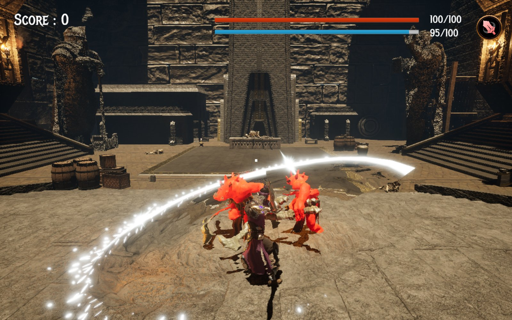
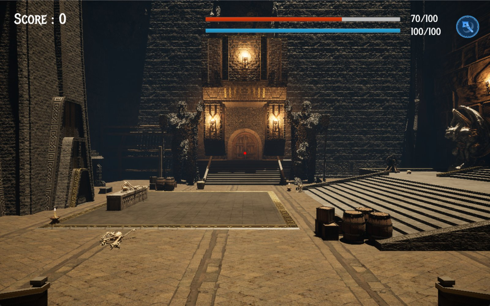
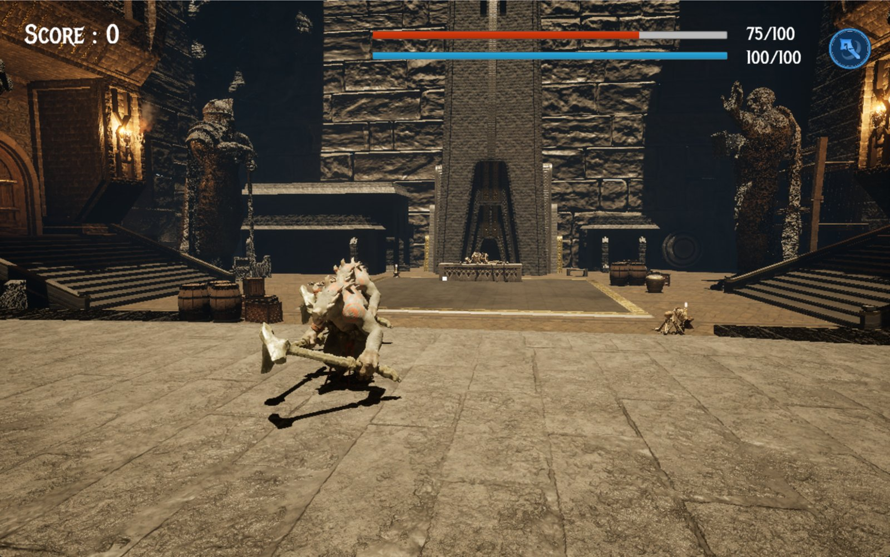
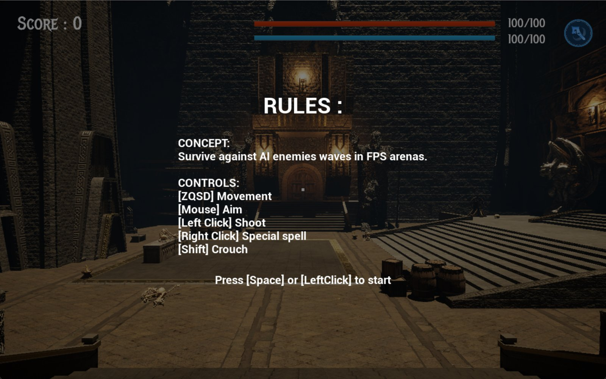

# Eternal Descent

A dungeon wave shooter made with Unreal Engine 5 (Blueprints) in a team of three,
for the "AI for FPS & Game Design" sprint of the Unreal Engine track at Epitech
Berlin (October-November 2025).

## The game

Pick a class (swordsman, archer or mage) and a difficulty, then survive waves of
goblins in the halls of a dwarven city, down to two boss arenas. Each class has a
primary attack, a special spell and its own animations, and stamina limits how
often you can attack.

| | |
|---|---|
|  |  |

## My part

- **Level design**: the whole map, from the dwarven city to the two boss rooms.
- **Menus and UI**: main menu, rules screen, class and difficulty selection,
  controls menu with key remapping that persists between levels, HUD (health,
  stamina, spell, score) and the screen damage effect.
- **Player character**: the class system (data assets per class), animations
  and part of the player's combat.

## Team

- [Lucas Debize](https://github.com/lucas-debize): enemy waves and spawning, AI,
  bosses, spells, visual and sound effects, difficulty curve and game loop.
- Lov3me Na: primary and secondary shots of the first classes, player sound effects.
- [Newen Calle](https://github.com/Newen95): level design, menus and UI, player
  character (see above).

The project was versioned with Diversion (not git) and relies on third-party
Marketplace assets that cannot be redistributed, so this repository is a
showcase with a playable build.

## Play it

1. Download both parts, `EternalDescent-Windows.7z.001` and `.002`, from the
   [latest release](https://github.com/Newen95/eternal-descent/releases/latest)
   into the same folder (about 3 GB in total).
2. Open the `.001` file with [7-Zip](https://www.7-zip.org/) and extract it; the
   second part is read automatically.
3. Run `Sprint2/GenerationDungeon.exe` (Windows, DirectX 12 GPU).

## Controls

The game uses an AZERTY layout by default (keys can be remapped in the controls
menu): `ZQSD` to move, mouse to aim, left click to attack, right click for the
special spell, `Shift` to crouch.
